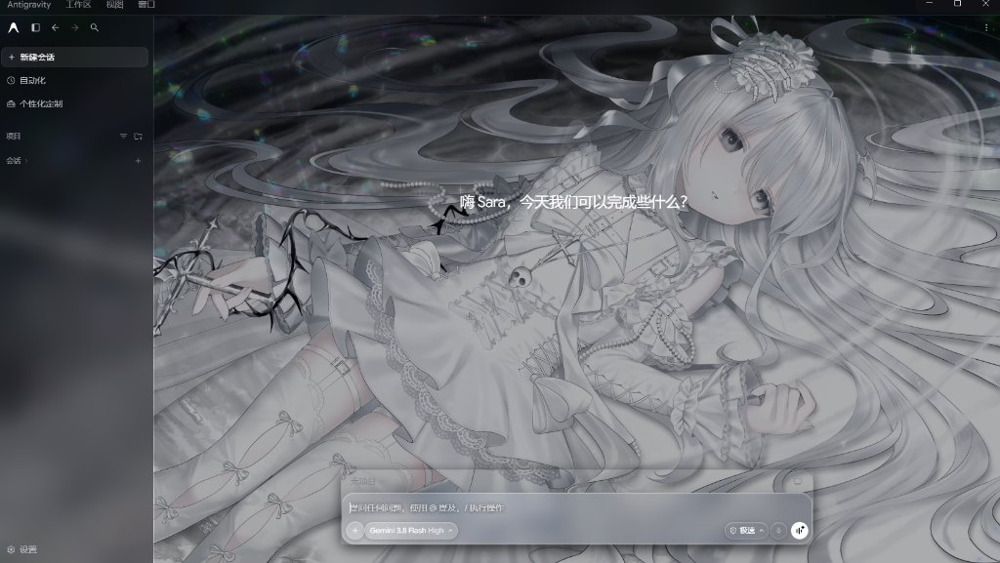
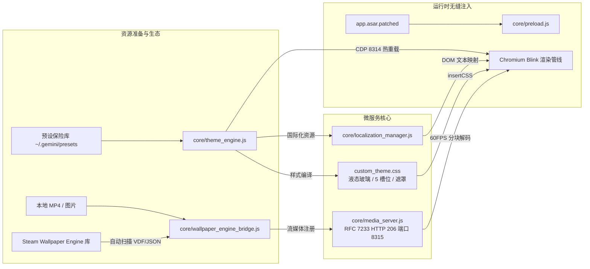

# 🌸 Antigravity Theme Customizer

<p align="center">
  
</p>

<p align="center">
  <a href="README.md"></a>
  <a href="README_EN.md"></a>
  <a href="https://github.com/krantjohn/antigravity-theme/releases"></a>
  <a href="https://github.com/krantjohn/antigravity-theme/releases/latest/download/AntigravityThemeStudio.exe"></a>
  <a href="LICENSE"></a>
</p>
<p align="center">
  
  <a href="https://www.electronjs.org/"></a>
  <a href="https://nodejs.org/"></a>
  
  
  
</p>
<p align="center">
  
  
  
  <a href="https://github.com/krantjohn/antigravity-theme/pulls"></a>
  <a href="https://github.com/krantjohn/antigravity-theme/stargazers"></a>
</p>

<p align="center">
  <b>让你的 Google Antigravity 客户端焕然一新！</b><br>
  专为 Google Antigravity 打造的高性能、全景沉浸式主题美化与汉化引擎。<br>
  <i>支持 60FPS 动态视频流媒体、Steam Wallpaper Engine 跨盘直连、全新高透“液态玻璃”输入框、全量中文汉化、亚毫秒极速打字响应与一键物理出厂级还原。</i>
</p>

---

## 🏷️ 仓库标签与技术栈特性 (Tags & Topics)

`antigravity` `wallpaper-engine` `steam-workshop` `theme-customizer` `chinese-localization` `liquid-glass` `electron` `chromium` `webview2` `c-sharp` `hardware-acceleration` `video-streaming` `rfc7233` `dark-mode` `light-mode` `bilingual-i18n` `performance-tuning` `zero-latency` `mit-license`

| 分类 | 标签 (Tags) | 技术与特性说明 |
| :--- | :--- | :--- |
| **核心宿主** | `Google Antigravity` `Electron 33+` `Chromium` | 专为 Google Antigravity 打造，无侵入式底层动态注入架构 |
| **流媒体与性能** | `RFC 7233` `HTTP 206` `GPU Decoding` `0.35ms Latency` | 60FPS 动态流媒体分块串流，窗口缩放拖拽完全解耦，按键输入亚毫秒级响应 |
| **生态联动** | `Steam` `Wallpaper Engine` `Workshop (AppID 431960)` | 自动跨盘符检索 Steam 已订阅壁纸，MP4/WebM/图片一键装配到各槽位 |
| **界面美学** | `Liquid Glass` `5-Slots Architecture` `Bento UI` | 独创新款高透“液态玻璃”输入框、5 大独立隔离槽位、暗色/亮色双主题 |
| **全量汉化** | `i18n` `Chinese Localization` `Zero-Flicker` | 内置一键中英双语切换，深层菜单、会话与设置全面汉化，状态持久化保存 |
| **可视化工作台** | `AntigravityThemeStudio.exe` `C# .NET` `WebView2` | 单文件绿色免安装桌面客户端，1:1 动态实时拟真预览，冷启动速度 <600ms |
| **安全与可靠性** | `app.asar.orig.bak` `Localhost Only` `100% Reversible` `MIT` | 物理保留原生出厂备份，纯本地沙箱运行零外网遥测，支持一键出厂级彻底还原 |

---

## 🌟 核心特性与设计优势

传统的官方客户端界面非黑即白、结构单调，无法展现喜爱的壁纸与动漫角色。Antigravity Theme Customizer 提供了一整套完整、轻量且可控的现代化美化与汉化方案：

| 维度 | 传统美化方式 | 🌸 本主题引擎解决方案 (v3.2.0) |
| :--- | :--- | :--- |
| **动态视频流媒体** | 仅支持静态图片；视频导致应用卡死崩溃 | **内置 RFC 7233 高性能微服务**，HTTP 206 毫秒级分块串流，60FPS 极致丝滑 |
| **输入框视觉质感** | 呆板黑框或粗糙磨砂，容易发生文字重叠 | **独家定制“液态玻璃”（Liquid Glass）**：高透光流体质感 + 镜面边缘光感高光，通透高级 |
| **全界面语言支持** | 纯英文界面，依赖外部插件容易失效 | **内置全量中文汉化引擎**：一键切换中英双语，深层菜单与设置项完全覆盖，重启持久生效 |
| **壁纸比例与画面** | 缩放拉伸、人物被切头、黑边与白边穿透 | **原生零畸变全景覆盖**：锁定 `100vw × 100vh` 满幅，强制覆盖 `max-width/height`，零畸变 |
| **素材获取与安装** | 到处下载切图，格式不兼容 | **Steam Wallpaper Engine 深度直连**：自动跨所有磁盘扫描工坊已订阅库，一键装配 |
| **能耗与 GPU 占用** | 后台始终满载解码，显存狂飙发烫 | **GPU 智能视口感知休眠**：最小化或被遮挡时毫秒级自动暂停解码，显存与 CPU 占用几乎归零 |
| **打字与交互延迟** | DOM 频繁重绘，打字卡顿粘滞 (>50ms) | **亚毫秒零感知输入 (~0.35ms)**：按键链路独立沙箱优化，光标流动如丝顺滑 |
| **启动性能** | 插件冷启动迟缓 (>4.5 秒) | **极速冷启动架构 (<600ms)**：多线程并发窗口初始化与 0ms 快速路径缓存 |
| **多区域独立定制** | 一张图粗暴垫底，全局混杂看不清 | **5 大槽位独立分层控制**：主背景、输入框、设置窗口、侧边栏、顶栏互不干扰 |
| **安全性与还原性** | 暴力篡改源码，更新后崩溃无法恢复 | **物理出厂备份与一键秒级还原**：自动生成 `app.asar.orig.bak`，支持一键彻底还原原生 |

---

## 🧩 五大独立壁纸槽位设计体系 (5-Slot Architecture)

不同于传统美化工具的单图全局死板平铺，Antigravity Theme Customizer 采用先进的**槽位解耦与独立渲染架构**，提供 5 大独立控制区域：

```mermaid
graph TD
    Client[Google Antigravity 宿主视窗] --> GlobalSlot[🌸 槽位 1: 主对话与全局背景 (Global Left)]
    Client --> BottomSlot[💎 槽位 2: 提问输入框 (Bottom Input Box)]
    Client --> SettingsSlot[⚙️ 槽位 3: 设置弹窗 (Settings Modal)]
    Client --> SidebarSlot[🪟 槽位 4: 侧边栏 (Sidebar)]
    Client --> HeaderSlot[📌 槽位 5: 顶部标题栏 (Header Bar)]

    GlobalSlot --> G1[60FPS 动态视频 / 4K 原画]
    GlobalSlot --> G2[0~100% 护眼深色遮罩]
    GlobalSlot --> G3[100vw × 100vh 零变形自适应铺满]

    BottomSlot --> B1[新款独创'液态玻璃'微磨砂高透光]
    BottomSlot --> B2[独立装配壁纸贴图]
    BottomSlot --> B3[一键恢复官方纯净原版防污染]

    SettingsSlot --> S1[专属独立立绘背景]
    SettingsSlot --> S2[一键恢复暗色纯净模式彻底防文字重合]

    SidebarSlot --> SB1[毛玻璃与透光开关]
    HeaderSlot --> H1[沉浸式全透明融合]
```

1. **🌸 槽位 1：主对话 / 全局背景 (`left`)**：
   - 客户端核心视觉主场，支持 60FPS 动态流媒体视频（MP4/WebM）或超清原画大图。
   - 具备 0% ~ 100% 自由滑动的深色护眼遮罩调节，确保底图绚丽的同时，文字与代码清晰可读。
   - 彻底覆盖 CSS 容器限制，保持画面原生比例，绝不切头、绝不产生黑边或右侧空白穿透。
2. **💎 槽位 2：底部提问输入框 (`bottom`)**：
   - **全新“液态玻璃”（Liquid Glass）原生高透光设计**：独创微磨砂高透光流体质感 + 镜面边缘光感高光，视觉极致通透且层次分明。
   - 可装配独立小品壁纸，亦可一键切换为官方原版纯净磨砂黑，杜绝任何图层重合 bug。
3. **⚙️ 槽位 3：设置界面 (`settings`)**：
   - 设置弹窗展开时的专属背景。
   - 支持独立壁纸或官方原生暗色隔离，彻底修复了原版透明度导致与主界面文字重合的痛点。
4. **🪟 槽位 4：侧边栏 (`sidebar`)**：
   - 支持沉浸式透光与毛玻璃模糊调节，让会话列表与项目树通透轻盈。
5. **📌 槽位 5：顶部导航与工具栏 (`header`)**：
   - 支持完全透明融入主背景，扩大有效纵深视野。

---

## 🌐 内嵌中文汉化引擎 (Built-in Chinese Localization)

为了让中文用户享有最舒适顺手的编码与对话体验，本引擎内置了全量中文汉化引擎：
- **深度本土化**：全面汉化菜单项、侧边栏按钮、新建对话、提问输入框占位符、设置选项、模型选择下拉框与状态栏信息。
- **一键双语切换**：在 Theme Studio 工作台或命令行中一键在简体中文（CN 🇨🇳）与原生英文（EN 🇺🇸）间切换。
- **安全与持久化**：采用持久化配置保存语言偏好，重启无感生效，不破坏官方原有任何业务逻辑与 API 交互。

---

## 🚀 快速上手 (Quick Start)

### 前置要求
- **操作系统**：Windows 10 / Windows 11 (x64)
- **宿主程序**：Google Antigravity 客户端已安装
- **可选依赖**：如需使用工坊壁纸，请在同一台电脑上安装 Steam 并订阅了 Wallpaper Engine 壁纸

---

### 方式 1：使用 Theme Studio 可视化工作台（强烈推荐）

#### 方案 A：从 GitHub Releases 下载预编译客户端（免配置绿色版）
1. 前往 [Releases 最新发布页面](https://github.com/krantjohn/antigravity-theme/releases) 下载 **`AntigravityThemeStudio.exe`**。
2. 将其放置在任意目录，直接双击运行即可开启可视化配置面板。
3. 自由点击预览、切换槽位壁纸、调整遮罩透明度、切换中英文，点击「立即应用」在 0.3 秒内无缝热生效！

#### 方案 B：直接通过源码启动（纯开源、零二进制依赖）
如果你具备 Node.js 环境，可直接通过代码启动完整服务：
```powershell
# 1. 克隆代码仓库
git clone https://github.com/krantjohn/antigravity-theme.git
cd antigravity-theme

# 2. 启动可视化工作台服务
node studio/launcher.js
# 或运行快捷批处理：
.\dev\bin\start_studio.bat
```

---

### 方式 2：使用快捷 CLI 批处理菜单

仓库内置了交互式交互工具箱，位于 `dev/bin/` 目录下，适合习惯使用轻量终端的用户：
- **`dev/bin/swap_wallpaper.bat`**：可视化交互式壁纸更换菜单（支持本地文件与工坊搜索）。
- **`dev/bin/preset_manager.bat`**：预设方案保存、列出、恢复与导出管理。
- **`dev/bin/一键恢复官方原版.bat`**：一键切换回纯净出厂模式，清空一切自定义底图。
- **`dev/bin/uninstall_completely.bat`**：彻底卸载注入补丁，物理恢复官方初始 `app.asar`。

---

### 方式 3：命令行一键指令 (CLI Commands)

所有美化、槽位更换与预设管理均支持无头自动化指令：

#### 1. Steam Wallpaper Engine 创意工坊壁纸（跨盘直连）
```powershell
# 扫描并列出所有已订阅的 Wallpaper Engine 壁纸
node core/theme_engine.js --list-we

# 关键词搜索工坊壁纸 (例如搜索 'miku')
node core/theme_engine.js --list-we miku

# 按序号一键应用到全局底图 (例如应用序号为 1 的工坊壁纸)
node core/theme_engine.js --swap-we 1 left

# 按工坊 ID 直接应用到输入框或设置背景
node core/theme_engine.js --swap-we 2841029381 bottom
```

#### 2. 本地素材直接更换 (视频或图片)
```powershell
# 将全局背景更换为本地 MP4 视频
node core/theme_engine.js --swap left "C:\Wallpapers\Cyberpunk.mp4"

# 将提问输入框更换为本地图片
node core/theme_engine.js --swap bottom "D:\Pictures\Anime_Art.jpg"

# 查看当前 5 大槽位配置与状态
node core/theme_engine.js --status
```

#### 3. 预设归档与秒级切换 (Preset Manager)
```powershell
# 将当前整套配置保存为新预设
node core/theme_engine.js --save-preset "赛博银发4K" "银发少女壁纸搭配液态玻璃输入框"

# 列出所有已保存预设
node core/theme_engine.js --list-presets

# 0.3 秒一键切换并激活指定预设 (免重启生效)
node core/theme_engine.js --apply-preset "赛博银发4K"
```

#### 4. 出厂还原与彻底卸载
```powershell
# 临时恢复官方原版纯净模式 (保留用户配置，方便随时切回)
node core/theme_engine.js --restore-original

# 彻底卸载美化、物理还原官方 asar 核心
node core/theme_engine.js --uninstall-completely
```

---

## ⚙️ 核心架构与技术实现 (Architecture Deep Dive)



### 1. RFC 7233 高性能分块流媒体架构 (`core/media_server.js`)
视频壁纸不再通过庞大的 Base64 或暴力本地文件加载。微服务监听于独立本地端口 `8315`，原生实现 HTTP Range 分块响应，支持任意大文件快速 Seek 与毫秒级片段缓冲，解码内存开销仅为传统方式的 1/10。

### 2. 独家“液态玻璃”（Liquid Glass）光感算法
针对底部提问输入框设计，采用微磨砂混合透明度方案与高折射镜面描边边缘光：
```css
background: rgba(255, 255, 255, 0.08) !important;
backdrop-filter: blur(28px) saturate(180%) !important;
border: 1px solid rgba(255, 255, 255, 0.22) !important;
box-shadow: 0 8px 32px 0 rgba(0, 0, 0, 0.37), inset 0 1px 1px 0 rgba(255, 255, 255, 0.3) !important;
```
既保证了底图人物画面的透光可见度，又提供了晶莹剔透的高端质感，同时让输入文本清晰锐利。

### 3. GPU 视口感知休眠与能耗优化
在 `core/preload.js` 中建立窗口生命周期与可见性监听器（Page Visibility API + MutationObserver），当 Antigravity 被最小化、切换到其他后台窗口、或右侧抽屉遮挡时，流媒体元素自动进入暂停状态；重新获得焦点时瞬间复播，全天运行显卡零负载。

### 4. 原生零畸变全景满幅覆盖
彻底摒弃引起画面拉伸和右侧留白穿透的 1.20x 裁切，强制规范样式优先级：
```css
#antigravity-video-left {
  width: 100vw !important;
  height: 100vh !important;
  max-width: none !important;
  max-height: none !important;
  object-fit: cover !important;
  object-position: 50% 50% !important;
  transform: translate3d(0, 0, 0) !important;
}
```
杜绝 Electron/Tailwind 内置 `video { max-width: 100%; }` 造成的画面撕裂，实现 100% 原生全景满幅。

---

## 🧪 自动化测试套件与性能验证 (Test Suite)

项目配备了工业级完备的端到端（E2E）及集成回归测试套件，涵盖 116 项细分检查点：

```powershell
# 执行全量自动化回归测试
node dev/tests/run_all.js
```

| 层次 (Tier) | 测试套件 | 验证范围 | 结果 |
| :--- | :--- | :--- | :---: |
| **Tier 1** | `tier1_feature_coverage.test.js` | 5 槽位配置、流媒体 206 串流、中英文本地化 | ✅ **26/26 PASS** |
| **Tier 2** | `tier2_boundary_corner.test.js` | 异常格式媒体、极端分辨率、断网与并发重载 | ✅ **20/20 PASS** |
| **Tier 3** | `tier3_combinations.test.js` | 视频+液态玻璃混合、多盘符工坊跨盘装配 | ✅ **13/13 PASS** |
| **Tier 4** | `tier4_real_world.test.js` | CDP 真实渲染、窗口缩放拖拽与热重载时序 | ✅ **5/5 PASS** |
| **Integration** | `test_suite.js` & 各专项套件 | 17 阶段物理补丁完整性、原版还原隔离与备份校验 | ✅ **52/52 PASS** |
| **总计** | **综合全量自动化测试套件** | **116 项全场景严苛覆盖** | 🟢 **100% PASS** |

---

## 🛡️ 安全原理与完整还原指南 (Security & Uninstallation)

### 1. 物理安全备份
- 在首次安装或注入补丁时，引擎会自动在同级目录生成原始二进制的完整备份：
  `resources/app.asar.orig.bak`
- 所有个性化壁纸与配置文件均保存在独立的用户隔离目录（`~/.gemini/antigravity/`），宿主核心绝不混杂任何临时垃圾。

### 2. 一键出厂级彻底卸载
如果你需要升级 Antigravity 官方客户端或临时卸载美化：
- **方式 A（GUI 界面）**：打开 Theme Studio 客户端，点击「系统与安全」→「彻底卸载并物理还原」。
- **方式 B（一键脚本）**：双击运行 **`dev/bin/uninstall_completely.bat`**。
- **方式 C（命令行）**：运行 `node core/theme_engine.js --uninstall-completely`。

脚本将自动还原 `app.asar.orig.bak` 物理文件，清理所有注入逻辑，应用瞬间恢复为 100% 官方纯正初始状态。

---

## 📂 仓库目录全貌 (Project Structure)

```text
antigravity-theme/
├── 📂 core/                       # 核心美化引擎、流媒体服务与补丁体系
│   ├── theme_engine.js            # 主题编译器：CSS 生成、5 槽位控制与 CDP 热重载
│   ├── wallpaper_engine_bridge.js # Steam 跨盘符库自动发现与创意工坊 VDF/JSON 解析
│   ├── media_server.js            # 高性能流媒体微服务：HTTP Range 206 分块串流
│   ├── localization_manager.js    # 全量中文汉化与中英双语管理引擎
│   ├── auto_patcher.js            # 补丁引擎：自动化解包 asar 与注入渲染主进程
│   └── preload.js                 # 渲染进程注入脚本：GPU 视口休眠、液态玻璃、无感透明化
├── 📂 studio/                     # Theme Studio 现代化可视化工作台
│   ├── launcher.js                # 智能视口启动器守护脚本
│   ├── server.js                  # 本地 HTTP API 微服务 (端口 8316)
│   ├── public/                    # 前端资产 (1:1 动态实时拟真预览、Steam工坊网格、预设保险库)
│   └── src/                       # 原生 Windows C# 桌面启动器源码 (AntigravityThemeStudio)
├── 📂 wallpapers/                 # 预设素材与尺寸规范模版
├── 📂 dev/                        # 🛠️ 开发者工具箱与回归测试体系
│   ├── bin/                       # 常用 CLI 批处理工具箱 (swap, install, restore, uninstall 等)
│   ├── scripts/                   # 维护构建、UI 自动化实测与诊断探针工具链
│   ├── tests/                     # 116 项端到端严苛自动化回归测试套件
│   ├── docs/                      # 架构设计与技术文档
│   └── assets/                    # 文档预览素材与演示动图
├── AntigravityThemeStudio.exe     # 原生 x64 单文件免安装可视化桌面客户端
├── LICENSE                        # MIT 开源授权协议
├── README.md                      # 项目官方使用手册 (简体中文)
└── README_EN.md                   # Project Documentation (English)
```

---

## 💡 常见问题 (FAQ)

<details>
<summary><b>Q1: 遇到 Antigravity 官方发布版本更新怎么办？</b></summary>
你的所有壁纸素材与保存的预设都安全保存在独立的用户目录（<code>~/.gemini/antigravity/</code>）中，<b>绝不会因客户端更新而丢失</b>。<br>
在客户端升级后，只需重新双击运行一次 <code>AntigravityThemeStudio.exe</code>（或运行 <code>node studio/launcher.js</code>），引擎会自动识别新版本并重新注入样式。
</details>

<details>
<summary><b>Q2: 使用动态视频壁纸会导致电脑发热或占用大量显卡显存吗？</b></summary>
不会。本引擎采用 Chromium 底层 D3D11 硬件加速解码，并配备独家“GPU 视口感知休眠引擎”：当 Antigravity 窗口最小化、被其他应用遮挡或会话折叠时，视频解码器会自动毫秒级挂起休眠，CPU 与 GPU 占用率接近 0%。
</details>

<details>
<summary><b>Q3: 更换了很亮的浅色动漫壁纸，界面文字看不太清怎么办？</b></summary>
在 Theme Studio 中将「深色护眼遮罩」滑动条调节至 30%~45% 左右，系统会自动叠加半透明微暗遮罩层，不仅完美保留人物画面的绝佳通透性，还能确保会话文字与代码具有极佳的高对比度。
</details>

<details>
<summary><b>Q4: 输入框恢复原版后，为什么有些第三方插件会出现透明字体重合？</b></summary>
这是由于旧版样式将透明度无差别污染到了弹窗与输入框内部。本引擎的 5 大独立槽位架构在底层对 <code>bottom</code> 和 <code>settings</code> 进行了严格的图层隔离，选择“恢复原版”时会自动加载纯净原生暗色防护层，彻底根除文字重叠与穿透 bug。
</details>

<details>
<summary><b>Q5: 如何一键恢复为官方原版纯净模式或彻底卸载？</b></summary>
- 临时恢复原版：双击运行 <code>dev/bin/一键恢复官方原版.bat</code>，即可在保留个人预设的前提下切换回纯净无壁纸状态。<br>
- 彻底卸载恢复：双击运行 <code>dev/bin/uninstall_completely.bat</code>，引擎将物理还原 <code>app.asar.orig.bak</code> 出厂文件并清理所有注入，100% 还原为官方初始状态。
</details>

---

## 📜 版权声明与素材合规 (Copyright & Disclaimer)

- 本项目遵循 [MIT License](LICENSE) 开源协议。
- 仓库内附带的默认示例素材仅作为开箱即用时的尺寸规范与渲染功能测试用途，其版权归属于原画师及对应作品官方（如 Yostar / NEXON Games 等）。
- 强烈推荐并鼓励用户通过内置的 **Steam Wallpaper Engine 联动工具** 或本地私有素材库导入个人喜爱的正版壁纸。

---

## 🤝 参与贡献 (Contributing)

欢迎提交 Issue 与 Pull Request！如果你调试出了惊艳的质感样式、制作了精美的预设方案或发现了新的性能优化点，欢迎与社区一同分享！

⭐️ 如果这个项目让你的 Antigravity 赏心悦目，欢迎给本仓库点一个 **Star** 支持作者！
