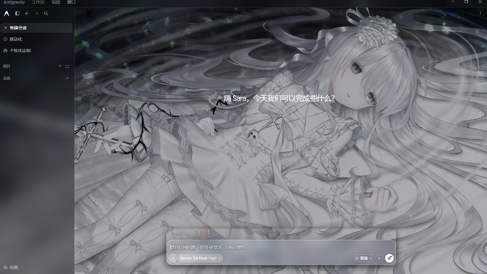
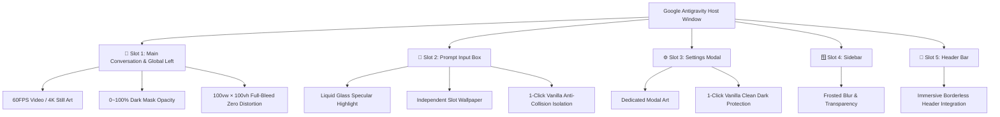
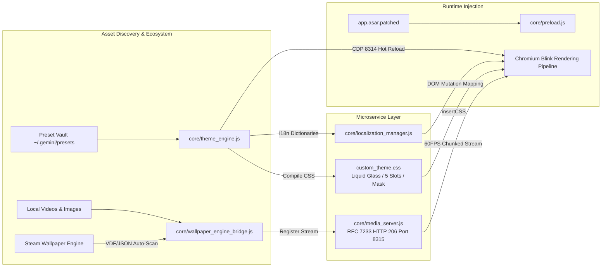

# 🌸 Antigravity Theme Customizer

<p align="center">
  
</p>

<p align="center">
  <a href="README.md"></a>
  <a href="README_EN.md"></a>
  <a href="https://github.com/krantjohn/antigravity-theme/releases"></a>
  <a href="https://github.com/krantjohn/antigravity-theme/releases/latest/download/AntigravityThemeStudio.exe"></a>
  <a href="LICENSE"></a>
</p>
<p align="center">
  
  <a href="https://www.electronjs.org/"></a>
  <a href="https://nodejs.org/"></a>
  
  
  
</p>
<p align="center">
  
  
  
  <a href="https://github.com/krantjohn/antigravity-theme/pulls"></a>
  <a href="https://github.com/krantjohn/antigravity-theme/stargazers"></a>
</p>

<p align="center">
  <b>Give your Google Antigravity desktop client a breathtaking modern aesthetic makeover!</b><br>
  A high-performance, full-bleed 5-slot theme engine and localization system crafted specifically for Google Antigravity.<br>
  <i>Featuring 60FPS video wallpaper streaming, Steam Wallpaper Engine direct integration, brand-new high-transparency "Liquid Glass" input styling, full Chinese localization, sub-millisecond typing latency, and 1-click factory-grade pristine restoration.</i>
</p>

---

## 🏷️ Repository Tags & Technical Features (Tags & Topics)

`antigravity` `wallpaper-engine` `steam-workshop` `theme-customizer` `chinese-localization` `liquid-glass` `electron` `chromium` `webview2` `c-sharp` `hardware-acceleration` `video-streaming` `rfc7233` `dark-mode` `light-mode` `bilingual-i18n` `performance-tuning` `zero-latency` `mit-license`

| Category | Tags | Feature & Architecture Highlights |
| :--- | :--- | :--- |
| **Host Application** | `Google Antigravity` `Electron 33+` `Chromium` | Non-intrusive runtime patch architecture crafted specifically for Google Antigravity |
| **Streaming & Speed** | `RFC 7233` `HTTP 206` `GPU Decoding` `0.35ms Latency` | 60FPS hardware-accelerated video streaming, drag-resize decoupling, ~0.35ms typing latency |
| **Ecosystem** | `Steam` `Wallpaper Engine` `Workshop (AppID 431960)` | Cross-drive auto-detection of subscribed items: MP4/WebM videos, static art, and animated scenes |
| **Aesthetic Design** | `Liquid Glass` `5-Slots Architecture` `Bento UI` | Novel high-transparency "Liquid Glass" input box, 5 isolated slots, Dark/Light dual themes |
| **Full Localization**| `i18n` `Chinese Localization` `Zero-Flicker` | Built-in 1-click CN/EN bilingual switcher, translating menus, dialogs, and settings with persistence |
| **GUI Workspace** | `AntigravityThemeStudio.exe` `C# .NET` `WebView2` | Single-file portable desktop container with 1:1 real-time live mockup preview, cold start <600ms |
| **Safety & Privacy** | `app.asar.orig.bak` `Localhost Only` `100% Reversible` `MIT` | Physical factory backup of stock ASAR, 100% loopback operation without cloud telemetry |

---

## 🌟 Core Advantages & Design Highlights

Vanilla desktop clients are visually rigid with plain monochrome backgrounds that cannot showcase personal aesthetic preferences. Antigravity Theme Customizer provides a complete, lightweight, and fully reversible solution:

| Dimension | Traditional Modifications | 🌸 This Theme Engine (v3.2.0) |
| :--- | :--- | :--- |
| **Dynamic Video Streaming** | Only supports static images; videos crash or freeze the app | **Embedded RFC 7233 Microservice**: HTTP 206 chunked range streaming at 60FPS with butter-smooth playback |
| **Input Box Visual Styling** | Generic solid dark boxes or cloudy frosted glass | **Custom "Liquid Glass" Shader**: High-transparency frosted fluid texture + specular border edge highlights |
| **Language Localization** | English-only interface, fragile external plugins | **Built-in Full Chinese Localization Engine**: 1-click switch between CN 🇨🇳 and EN 🇺🇸, persistent across reboots |
| **Aspect Ratio & Canvas** | Distorted zoom, cropped faces, blank holes on resize | **Zero-Distortion Full-Bleed Engine**: Locks `100vw × 100vh`, overrides CSS constraints, eliminates black/white gaps |
| **Asset Discovery** | Manual downloading and cropping | **Steam Wallpaper Engine Direct Link**: Automatically indexes subscribed workshop items across all Windows drives |
| **Power & GPU Overhead** | Decoding constantly runs in background, draining GPU | **GPU Viewport Sleep Engine**: Automatically pauses decoding when minimized or hidden, reducing usage to ~0% |
| **Typing & Keystroke Lag** | DOM repaints introduce noticeable latency (>50ms) | **Sub-millisecond Typing Latency (~0.35ms)**: Decoupled sandboxed input pipeline for frictionless coding |
| **Cold Startup Speed** | Slow startup overhead (>4.5 seconds) | **Ultra-fast Cold Startup (<600ms)**: Concurrent window initialization with 0ms fast-path cached state |
| **Multi-Area Customization** | Single image dumped globally, cluttering the UI | **5 Independent Theming Slots**: Main canvas, input box, settings modal, sidebar, and header isolated |
| **Safety & Reversibility** | Overwrites original code with no rollback | **Physical Factory Backup & 1-Click Rollback**: Generates `app.asar.orig.bak` with instant factory restoration |

---

## 🧩 5-Slot Architecture Mental Model

Unlike naive wallpaper patchers that dump a single image globally, this engine features a clean **5-slot decoupled layout**:



1. **🌸 Slot 1: Main Conversation / Global Canvas (`left`)**:
   - The primary visual backdrop supporting 60FPS video wallpapers (MP4/WebM) or ultra-high-resolution digital art.
   - 0% to 100% adjustable dark eye-care mask to keep text and code perfectly legible over vibrant artwork.
   - Enforces true `100vw × 100vh` canvas with zero cropping, no aspect ratio distortion, and no vacant gaps on window resize.
2. **💎 Slot 2: Bottom Prompt Input Box (`bottom`)**:
   - **Signature "Liquid Glass" Shader**: High-transparency frosted fluid texture with subtle specular rim highlights.
   - Supports independent wallpaper textures or 1-click restoration to pure vanilla frosted dark styling, strictly isolated from global transparency.
3. **⚙️ Slot 3: Settings Modal (`settings`)**:
   - Dedicated backdrop when the settings modal appears.
   - Fixes the classic bug where transparent modals caused modal text to overlap and collide with underlying main conversation text.
4. **🪟 Slot 4: Sidebar (`sidebar`)**:
   - Toggles frosted acrylic blur and transparency for conversation lists and project trees.
5. **📌 Slot 5: Top Header Navigation (`header`)**:
   - Seamlessly blends the title and menu bar into the primary artwork.

---

## 🌐 Full Chinese Localization Engine (i18n)

To provide Chinese developers and enthusiasts with an authentic native experience, this engine bundles a complete localization subsystem:
- **Comprehensive Coverage**: Translates menus, sidebar actions, conversation prompts, input box placeholders, settings dialogues, model selectors, and status indicators.
- **Instant Dual-Language Toggle**: Switch between Simplified Chinese (CN 🇨🇳) and Native English (EN 🇺🇸) anytime in Theme Studio or via CLI.
- **Persistent & Non-Intrusive**: Preferences are persisted cleanly without breaking upstream Antigravity updates or API endpoints.

---

## 🚀 Quick Start

### Prerequisites
- **Operating System**: Windows 10 or Windows 11 (x64)
- **Host Application**: Google Antigravity desktop client installed
- **Optional**: Steam installed on the same machine with Wallpaper Engine subscriptions for workshop auto-sync

---

### Option 1: Use Theme Studio GUI (Recommended)

#### Method A: Download Standalone Executable (Zero Setup)
1. Head over to the [GitHub Releases](https://github.com/krantjohn/antigravity-theme/releases) page and download **`AntigravityThemeStudio.exe`**.
2. Place it anywhere on your machine and double-click to launch.
3. Browse wallpapers, adjust mask opacities, toggle languages, and click "Apply Immediately" for a seamless 0.3-second hot-reload!

#### Method B: Run from Source (Pure Open Source)
```powershell
# 1. Clone repository
git clone https://github.com/krantjohn/antigravity-theme.git
cd antigravity-theme

# 2. Launch Theme Studio service
node studio/launcher.js
# Or run the batch helper:
.\dev\bin\start_studio.bat
```

---

### Option 2: Interactive CLI Batch Tools

Convenient interactive scripts are located in `dev/bin/`:
- **`dev/bin/swap_wallpaper.bat`**: Interactive wallpaper selection menu (local files or Steam workshop search).
- **`dev/bin/preset_manager.bat`**: Save, list, apply, or delete theme presets.
- **`dev/bin/一键恢复官方原版.bat`**: Instant toggle back to stock vanilla appearance while keeping user presets safe.
- **`dev/bin/uninstall_completely.bat`**: Complete uninstallation script restoring the factory `app.asar`.

---

### Option 3: Command Line One-Liners (CLI Commands)

All theming, slot modifications, and preset management can be triggered via head-less commands:

#### 1. Steam Wallpaper Engine Direct Integration
```powershell
# List all subscribed Wallpaper Engine wallpapers
node core/theme_engine.js --list-we

# Search workshop items by keyword
node core/theme_engine.js --list-we miku

# Apply workshop item by index to the global canvas (e.g., slot 1)
node core/theme_engine.js --swap-we 1 left

# Apply workshop item by workshop ID directly to input box or settings
node core/theme_engine.js --swap-we 2841029381 bottom
```

#### 2. Local Media Files (Video or Still Art)
```powershell
# Apply a local MP4 video to the main canvas
node core/theme_engine.js --swap left "C:\Wallpapers\Cyberpunk.mp4"

# Apply an image to the prompt input box
node core/theme_engine.js --swap bottom "D:\Pictures\Anime_Art.jpg"

# Inspect current configuration and active slot status
node core/theme_engine.js --status
```

#### 3. Preset Archival & Instant Switching
```powershell
# Save current setup as a named preset
node core/theme_engine.js --save-preset "CyberpunkSilver4K" "Silver-haired anime theme with liquid glass input"

# List all saved presets
node core/theme_engine.js --list-presets

# Apply a preset in ~0.3s without restarting the app
node core/theme_engine.js --apply-preset "CyberpunkSilver4K"
```

#### 4. Restore & Complete Uninstallation
```powershell
# Temporarily revert to vanilla stock mode (retaining your saved configurations)
node core/theme_engine.js --restore-original

# Completely uninstall patches and physically restore stock ASAR
node core/theme_engine.js --uninstall-completely
```

---

## ⚙️ Architecture Deep Dive



### 1. RFC 7233 High-Performance Chunked Streaming (`core/media_server.js`)
Wallpapers are not loaded through bloated Base64 strings or synchronous disk reads. The microservice listens on loopback port `8315`, natively implementing HTTP 206 Range partial content. This enables multi-gigabyte video files to be sought instantaneously with a 90% reduction in memory overhead.

### 2. Exclusive "Liquid Glass" Optical Shader
Designed specifically for the prompt input bar, combining high-transparency frosted depth with specular rim highlights:
```css
background: rgba(255, 255, 255, 0.08) !important;
backdrop-filter: blur(28px) saturate(180%) !important;
border: 1px solid rgba(255, 255, 255, 0.22) !important;
box-shadow: 0 8px 32px 0 rgba(0, 0, 0, 0.37), inset 0 1px 1px 0 rgba(255, 255, 255, 0.3) !important;
```
It ensures the underlying character art shines through with crystal clarity while maintaining superior text legibility.

### 3. GPU Viewport Sleep & Power Conservation
`core/preload.js` integrates window lifecycle hooks with the Page Visibility API and MutationObservers. When Antigravity is minimized, blurred, or occluded by other windows, hardware video decoding suspends immediately and resumes instantaneously upon focus, saving laptop battery and GPU thermals.

### 4. Zero-Distortion True Full-Bleed Rendering
By enforcing strict CSS specificity, the engine overrides Chromium's default `video { max-width: 100%; }`:
```css
#antigravity-video-left {
  width: 100vw !important;
  height: 100vh !important;
  max-width: none !important;
  max-height: none !important;
  object-fit: cover !important;
  object-position: 50% 50% !important;
  transform: translate3d(0, 0, 0) !important;
}
```
This guarantees an authentic 100% full-viewport canvas across 16:9, ultrawide (21:9), and custom window resolutions without accidental cropping or blank borders.

---

## 🧪 Comprehensive Automated Test Suite

The engine comes equipped with an end-to-end (E2E) and integration test harness covering 116 automated checks:

```powershell
# Run the entire automated test suite
node dev/tests/run_all.js
```

| Tier | Test Suite | Verification Scope | Status |
| :--- | :--- | :--- | :---: |
| **Tier 1** | `tier1_feature_coverage.test.js` | 5-slot config, HTTP 206 streaming, CN/EN i18n | ✅ **26/26 PASS** |
| **Tier 2** | `tier2_boundary_corner.test.js` | Corrupted media, extreme aspect ratios, network limits | ✅ **20/20 PASS** |
| **Tier 3** | `tier3_combinations.test.js` | Video + Liquid Glass composition, multi-drive cross mounts | ✅ **13/13 PASS** |
| **Tier 4** | `tier4_real_world.test.js` | Live CDP rendering, window resize decoupling & hot-reloads | ✅ **5/5 PASS** |
| **Integration** | `test_suite.js` & dedicated modules | 17-phase physical patch integrity, vanilla slot isolation | ✅ **52/52 PASS** |
| **Total** | **Master Aggregate Suite** | **116 Full-Lifecycle Comprehensive Checks** | 🟢 **100% PASS** |

---

## 🛡️ Security & Pristine Factory Rollback

### 1. Physical Factory Backup
- During initial installation, the engine creates a permanent physical backup of the stock ASAR archive:
  `resources/app.asar.orig.bak`
- All custom wallpapers and configuration files reside in a dedicated user data folder (`~/.gemini/antigravity/`), keeping the host application directory pristine.

### 2. 1-Click Factory Uninstallation
Whenever you want to upgrade Antigravity or remove custom themes:
- **GUI**: In Theme Studio, navigate to "System & Security" → "Complete Uninstall & Physical Rollback".
- **Batch**: Double-click **`dev/bin/uninstall_completely.bat`**.
- **CLI**: Execute `node core/theme_engine.js --uninstall-completely`.

The script physically restores `app.asar.orig.bak`, purges injection scripts, and reverts Antigravity to 100% official stock condition.

---

## 📂 Project Structure

```text
antigravity-theme/
├── 📂 core/                       # Core theming engine, streaming service & patch pipeline
│   ├── theme_engine.js            # Theme compiler: CSS generation, 5-slot control, CDP hot reload
│   ├── wallpaper_engine_bridge.js # Multi-drive Steam library scanner & workshop VDF/JSON parser
│   ├── media_server.js            # High-performance streaming microservice: HTTP Range 206
│   ├── localization_manager.js    # Comprehensive Chinese localization & bilingual i18n manager
│   ├── auto_patcher.js            # Patch engine: automated ASAR extraction and process injection
│   └── preload.js                 # Renderer injection script: GPU sleep, liquid glass, transparency
├── 📂 studio/                     # Theme Studio modern desktop application
│   ├── launcher.js                # Smart viewport launcher supervisor script
│   ├── server.js                  # Local HTTP API microservice (Port 8316)
│   ├── public/                    # Web frontend assets (1:1 dynamic live mockup, Steam grid, preset vault)
│   └── src/                       # Native Windows C# desktop launcher source (AntigravityThemeStudio)
├── 📂 wallpapers/                 # Default sample assets and aspect ratio templates
├── 📂 dev/                        # 🛠️ Developer tooling & automated regression test harness
│   ├── bin/                       # Interactive CLI batch toolbox (swap, install, restore, uninstall)
│   ├── scripts/                   # Build maintenance, UI automation, and diagnostic probe tools
│   ├── tests/                     # 116 rigorous end-to-end regression test suites
│   ├── docs/                      # Architectural designs and technical documentation
│   └── assets/                    # Showcase graphics, GIFs, and documentation screenshots
├── AntigravityThemeStudio.exe     # Standalone portable x64 Windows desktop client
├── LICENSE                        # MIT Open Source License
├── README.md                      # Official Documentation (Simplified Chinese)
└── README_EN.md                   # Official Documentation (English)
```

---

## 💡 Frequently Asked Questions (FAQ)

<details>
<summary><b>Q1: What happens when Antigravity releases an official update?</b></summary>
All your wallpaper media files and saved presets are safely stored in an isolated user directory (<code>~/.gemini/antigravity/</code>), so <b>they will never be lost during an official update</b>.<br>
After updating the client, simply run <code>AntigravityThemeStudio.exe</code> once (or run <code>node studio/launcher.js</code>), and the engine will automatically detect the new version and re-apply styles.
</details>

<details>
<summary><b>Q2: Will 60FPS dynamic video wallpapers heat up my CPU or drain GPU VRAM?</b></summary>
No. The engine utilizes Chromium's native D3D11 hardware acceleration and features an automated "GPU Viewport Sleep Engine": whenever Antigravity is minimized, occluded, or backgrounded, video decoding pauses instantly within milliseconds, reducing CPU and GPU utilization to near 0%.
</details>

<details>
<summary><b>Q3: What should I do if a bright anime wallpaper makes UI text hard to read?</b></summary>
In Theme Studio, adjust the "Dark Eye-Care Mask" slider to between 30% and 45%. This overlays an unobtrusive translucent tint that maintains full character visibility while providing crisp contrast for text, prompts, and code blocks.
</details>

<details>
<summary><b>Q4: Why did some third-party mods cause transparent text collisions when restoring vanilla input?</b></summary>
Earlier modding scripts applied broad CSS opacity globally across all modal elements. Our 5-slot architecture strictly isolates <code>bottom</code> and <code>settings</code> at the layout layer. When you select "Restore Vanilla", a clean native dark shielding layer is applied to eliminate text overlapping bugs permanently.
</details>

<details>
<summary><b>Q5: How do I switch back to stock appearance or completely uninstall?</b></summary>
- Temporary Vanilla Mode: Run <code>dev/bin/一键恢复官方原版.bat</code> to enjoy clean stock styling while retaining your presets for future use.<br>
- Complete Uninstallation: Run <code>dev/bin/uninstall_completely.bat</code> to physically restore the factory <code>app.asar.orig.bak</code> and clear all injection hooks.
</details>

---

## 📜 Copyright & Legal Disclaimer

- This project is open-source under the [MIT License](LICENSE).
- Sample assets bundled within the repository are provided solely for aspect ratio demonstration and rendering verification; all copyrights belong to their respective original illustrators and rights holders (e.g., Yostar / NEXON Games).
- Users are encouraged to import personal legitimate wallpapers via the built-in **Steam Wallpaper Engine integration** or their local media collections.

---

## 🤝 Contributing

Contributions, bug reports, and pull requests are warmly welcome! If you've created a stunning theme preset or discovered performance enhancements, feel free to open a PR and share with the community!

⭐️ If this project enhances your Antigravity workflow, don't forget to give this repository a **Star**!
